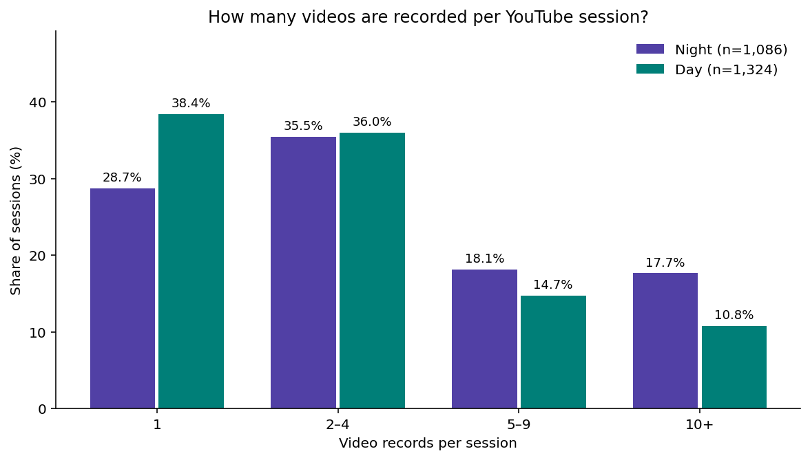

# Do My Late-Night YouTube Sessions Include More Videos?

## Research Question

Do my YouTube sessions that start between 22:00 and 06:00 contain more video records than those that start between 06:00 and 22:00?

## Data and Method

I used my personal YouTube watch history exported through Google Takeout. After filtering, the dataset contains 12,841 video records from November 2023 to November 2026. A gap of at least 30 minutes starts a new session. Each session is classified by its start time in the Europe/Istanbul time zone.

## Preliminary Findings

| Session start | Sessions | Mean video records | Median video records |
| --- | ---: | ---: | ---: |
| Late night | 1,086 | 6.33 | 3 |
| Daytime | 1,324 | 4.50 | 2 |

Using the 30-minute session definition, 17.7% of late-night sessions contained at least 10 video records, compared with 10.8% of daytime sessions. After excluding these sessions from both groups, the mean difference fell from 1.83 to 0.36 video records per session. This suggests that sessions with many video records account for much of the observed gap.

Late-night sessions had more video records on average at all three gap thresholds tested (20, 30, and 45 minutes). At the 20-minute threshold, both groups had a median of 2. The analysis measures the number of video records per session.

[View the analysis notebook and chart](dsa210_youtube_sessions.ipynb)
